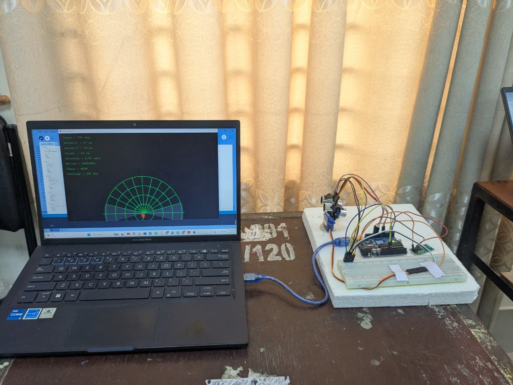
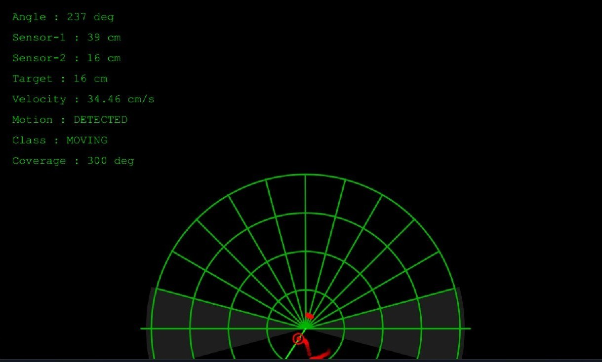

# Arduino-Based Ultrasonic Radar System

A low-cost, radar-style object detection system built around an Arduino Uno. An HC-SR04 ultrasonic sensor mounted on a servo sweeps an arc and measures the distance to objects. A second, fixed HC-SR04 gives velocity information, and an RCWL-0516 microwave sensor detects motion. The Arduino sends the data over USB to a laptop, which shows it on a radar display.

Group project for EEE 3100 (Electronics Shop Practice), Department of Electrical and Electronic Engineering, Rajshahi University of Engineering & Technology (RUET). The project report was submitted on 14 June 2026.



## Demo video

[Watch the project video on Google Drive](https://drive.google.com/file/d/1vy8tJJpiTDtDfKLlMJdKPFxwBwXRB3BL/view) (about 16 MB).

## What the system does

- **Distance and angle:** the servo turns the front HC-SR04 across the scan area. The sensor sends an ultrasonic pulse and times the echo, and the servo position gives the angle of each detected object.
- **Velocity:** a second, fixed HC-SR04 measures distance repeatedly. The change in distance between two readings divided by the time between them gives the approach speed of a moving object (`v = Δd / Δt`).
- **Motion trigger:** an RCWL-0516 microwave Doppler sensor reports that something is moving in its field, independent of the ultrasonic sweep.
- **Display:** the laptop shows a green polar radar grid with a sweep line and the detected objects, plus a readout of the current values.



The readout on the display shows: angle, Sensor-1 distance, Sensor-2 distance, target distance, velocity (cm/s), motion state, object class and coverage.

## How it works

The distance to an object is calculated from the time of flight of the ultrasonic pulse:

```
d = (v x t) / 2
```

where `d` is the distance to the object, `v` is the speed of sound and `t` is the measured echo time. The division by 2 is needed because the pulse travels to the object and back.

The processing loop, as shown on the project poster:

1. Detect motion (RCWL-0516)
2. Rotate the servo
3. Transmit an ultrasonic pulse
4. Receive the echo
5. Calculate the distance
6. Determine the angle
7. Send the data to the laptop
8. Update the radar display
9. Continue the scan

## Arduino sketch

`arduino-based-radar.ino` runs on the Arduino Uno. It follows the design in the project report:

- The servo sweeps the front HC-SR04 from 15 to 165 degrees and back in 1 degree steps, with a 25 ms wait for the servo to settle at each step.
- A scalar Kalman filter (process noise Q = 0.01, measurement noise R = 0.1) smooths the servo angle that is sent to the display.
- The fixed HC-SR04 is read at every step, and the approach speed is computed from two consecutive readings.
- The speed is turned into a class with fixed thresholds:

| Speed | Class |
| --- | --- |
| below 0.3 m/s | STATIC |
| 0.3 to 0.8 m/s | SLOW |
| 0.8 to 2.5 m/s | BIRD |
| above 2.5 m/s | VEHICLE |

- The sweep sensor reports objects between 2 cm and 40 cm. Anything else is sent as distance 0.

The sketch prints one line per servo step at 115200 baud:

```
smoothed_angle,distance_cm,velocity_m_s,rcwl_state,label
```

For example: `90.0,23.4,0.00,0,STATIC`. The constants at the top of the sketch (pins, sweep range, filter values, thresholds) can be changed for a different set-up.

## Hardware

| Part | Quantity | Cost (BDT) |
| --- | --- | --- |
| Arduino Uno R3 | 1 | 500 |
| HC-SR04 ultrasonic sensor | 2 | 120 |
| SG90 servo motor | 1 | 120 |
| RCWL-0516 microwave Doppler module | 1 | 80 |
| Breadboard (830 tie-points) | 1 | 120 |
| Jumper wires (male to male) | 1 set | 80 |
| USB cable, Type B | 1 | 60 |
| Mounting bracket and tape | 1 set | 50 |
| **Total** | | **1,130** |

A laptop runs the radar display (Processing) and receives the data over the serial connection. The project was self-financed.

## Wiring (pins used in the sketch)

| Part | Arduino pins |
| --- | --- |
| HC-SR04 #1 (on the servo, sweep) | TRIG D10, ECHO D11 |
| HC-SR04 #2 (fixed, velocity) | TRIG D6, ECHO D7 |
| SG90 servo signal | D12 |
| RCWL-0516 OUT | D2 |

All sensors share the 5 V and GND rails of the breadboard.

## Build and run

1. Wire the parts as in the table above.
2. Open `arduino-based-radar.ino` in the Arduino IDE and select the **Arduino Uno** board. The sketch uses the `Servo` library, which comes with the Arduino IDE.
3. Upload the sketch and open the Serial Monitor at **115200 baud**. A line of values appears for every servo step.
4. A program on the laptop (for example a Processing sketch) can read the same lines from the serial port and draw the radar display. The Processing sketch is not part of this repository.

## Notes

- The report is the project plan and design description, and it lists expected results. Values such as the sweep range, the velocity thresholds and the accuracy in the report are design targets, not measurements recorded in this repository.
- Future work listed on the poster: machine learning classification, wireless communication, multi-sensor fusion and IoT integration.

## Repository contents

```
arduino-based-radar/
  arduino-based-radar.ino          Arduino sketch
  arduino-based-radar-report.pdf   Project report
  arduino-based-radar-poster.pdf   Project poster
  exp-set-up.jpg                   Photo of the prototype
  radar-display.jpg                Photo of the radar display
  README.md
```

## Authors

- Md. Raiyan Mahmud
- Abu Huraira Kawshik
- Md. Buniatul Islam

Raiyan's portfolio: https://raiyan2064.github.io
